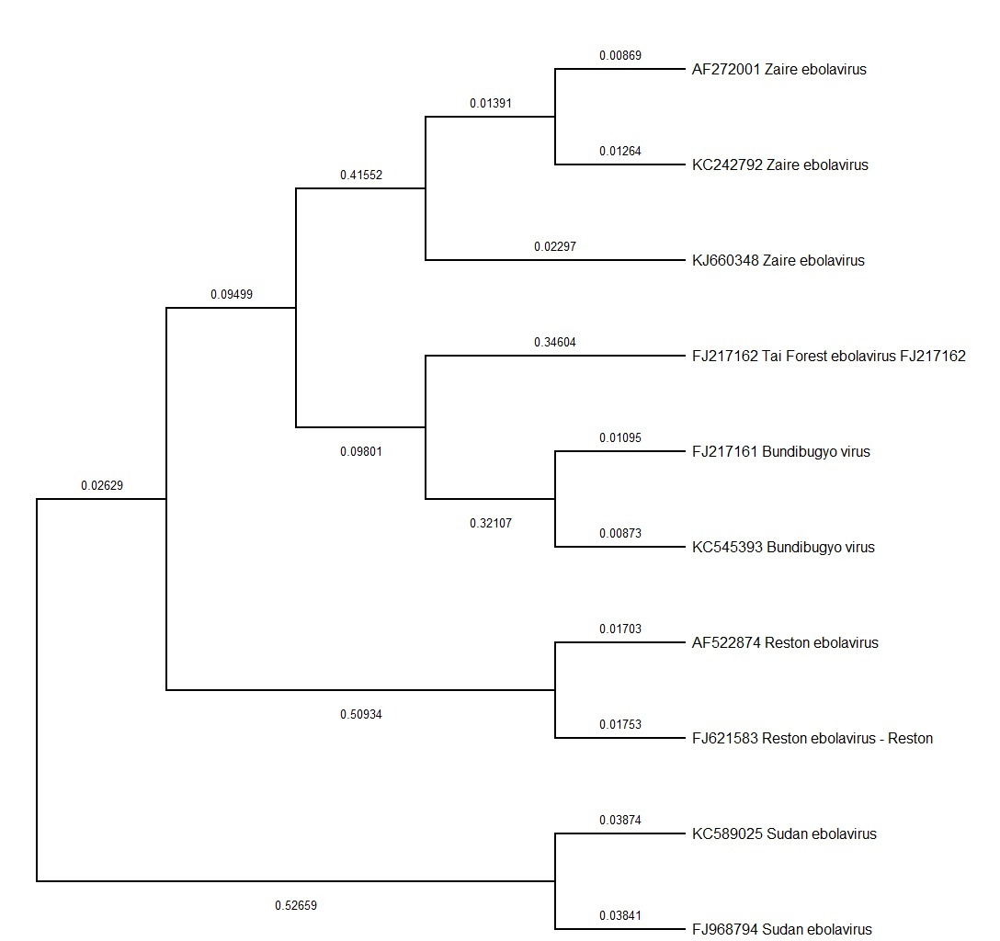
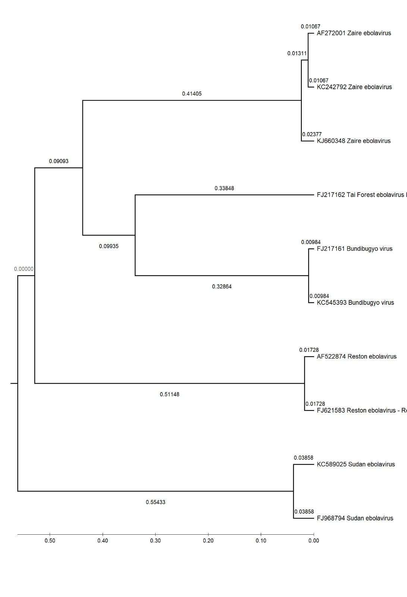
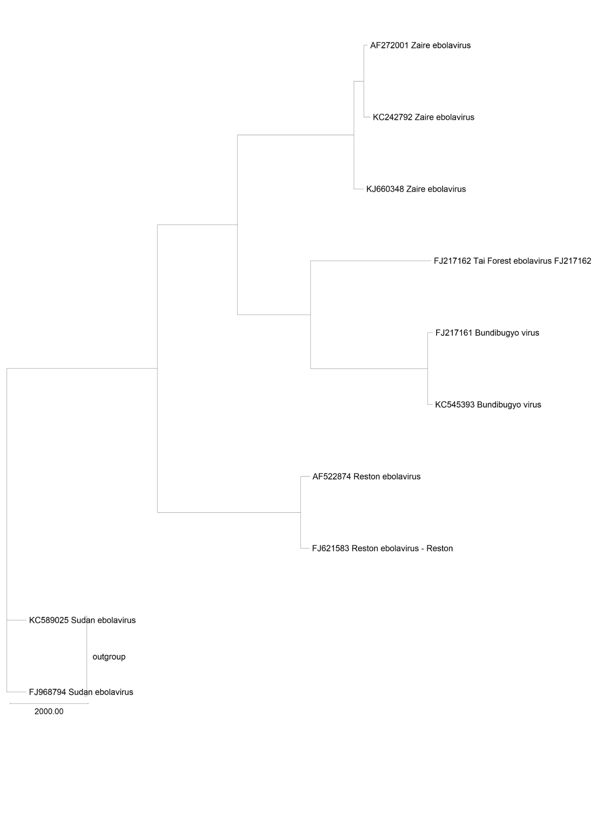

# Ebola Virus 2014 Phylogenomics & Mutation Analysis
# (Part of Coursera's Bioinformatics Specialization Course)


## Overview
This repository contains an automated Python-based computational framework for analyzing genomic variation, pairwise substitution matrices, and phylogenetic tree characteristics across 2014 West African *Zaire ebolavirus* strains, specifically evaluating target accession **`KJ660348`**. 

The pipeline automates multi-sequence alignment processing using **Biopython**, providing reproducible, programmatic calculations for site polymorphism, total mismatch sums, and tree branch distributions.

---

## Project Structure

```text
ebola-phylogenomics-capstone/
├── data/
│   └── ebola_sequences.fasta      # Aligned genomic FASTA sequences (19,220 bp)
├── results/
│   └── analysis_summary.txt      # Generated analysis outputs and logs
├── scripts/
│   └── analyze_ebola.py          # Core Python execution script
├── .gitignore
├── requirements.txt               # Environment dependencies
└── README.md                      # Project documentation

```

---

## Methodology & Findings

1. **Sequence Alignment:** 10 full-length viral genomes across a 19,220 bp alignment length.
2. **Programmatic Phylogenomic Summary:**

| Metric | Programmatic Value | Analytical Description |
| --- | --- | --- |
| **Sequences Analyzed** | **10** | Full-length viral genomes evaluated. |
| **Alignment Length** | **19,220 bp** | Complete multi-sequence alignment length. |
| **Polymorphic / Variable Sites** | **11,790** | Alignment positions displaying variation relative to reference `KJ660348`. |
| **Total Reference Substitutions** | **51,306** | Cumulative point mismatches summed across all non-reference genomes relative to `KJ660348`. |
| **Global Pairwise Mismatches** | **285,295** | Summed uncorrected sequence mismatches across all 45 unique taxa pairs. |
| **Terminal Substitutions (NJ Tree)** | **5,248** | Tree-aware substitution count assigned to external tip branches on a Neighbor-Joining tree. |

---

<div align="center">

  <!-- 1. NEIGHBOR-JOINING TREE -->
  <h3>1. Neighbor-Joining (NJ) Distance Tree</h3>
  
  <p><em>Figure 1: Neighbor-Joining tree constructed in MEGA showing evolutionary distances across Orthoebolavirus species relative to reference accession KJ660348.</em></p>

  <br/>

  <!-- 2. UPGMA TREE -->
  <h3>2. UPGMA Evolutionary Tree</h3>
  
  <p><em>Figure 2: UPGMA tree displaying the ultrametric molecular clock property where all leaf tips terminate at an equal divergence depth.</em></p>

  <br/>

  <!-- 3. MAXIMUM PARSIMONY TREE -->
  <h3>3. Maximum Parsimony (MP) Tree</h3>
  
  <p><em>Figure 3: Outgroup-rooted Maximum Parsimony phylogram mapping character state mutations across all 10 viral genomes.</em></p>

</div>


## Getting Started

### Prerequisites

* Python 3.8+
* Biopython

### Installation & Execution

1. Clone the repository:

```bash
git clone [https://github.com/usmanyalwa/ebola-phylogenomics-capstone.git](https://github.com/usmanyalwa/ebola-phylogenomics-capstone.git)
cd ebola-phylogenomics-capstone

```

2. Install dependencies:

```bash
pip install -r requirements.txt

```

3. Run the mutation analysis pipeline:

```bash
python scripts/analyze_ebola.py

```

---

## Author

* **Usman Yalwa Ibrahim** — *M.Sc. Bioinformatics*